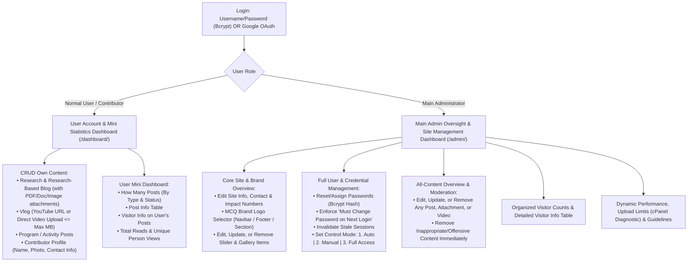

# A Greener Tomorrow (`greener2morow.org`) — Official Release: Version 2

> **Release Name:** **Version 2 (`v2.0`)** — European Eco-Editorial Design System, Left-Sidebar Admin Governance Console, Threaded Member Comments & Replies, In-Place Authentication, and Namecheap cPanel Production Package  
> **Designer & Developer:** [rknz](mailto:rukonuzzaman.dev@gmail.com) (`rukonuzzaman.dev@gmail.com`)  
> **Status:** Version 2 Full Production Code Completed (Portable PHP 8+ MVC Architecture) — Ready for immediate Namecheap shared hosting (cPanel), Apache, or Nginx deployment with zero-build compilation required.

---

## 1. Organization Profile & Official Brand Assets

| Field | Value / Specification |
| :--- | :--- |
| **Organization Name** | **A Greener Tomorrow** *(Action & Mobilization Model: "Sofiq Organization" Environmental Blueprint)* |
| **Organization Mission** | Initiates, plans, and executes programs and events addressing **Climate Change**, **Environmental Pollution**, **Deforestation**, and **Natural Disasters**, mobilizing youth and citizens to participate actively. |
| **5 Core Focus Pillars** | 1. **Climate Change** (`CLIMATE`)<br>2. **Environmental Conservation** (`ENVIRONMENT`)<br>3. **Deforestation & Afforestation** (`DEFORESTATION`)<br>4. **Environmental Pollution** (`POLLUTION`)<br>5. **Natural Disasters & Relief** (`DISASTER`) |
| **Official Address** | 36, Bir Uttam C.R Dutta Road, Hatirpool, Dhaka-1205, Bangladesh |
| **Official Email** | `greener2morow@gmail.com` |
| **Official Website** | `https://greener2morow.org` |
| **Official Brand Logo** | [`brand logo.png`](./brand%20logo.png) |
| **Official Color Template** | [`color templete.png`](./color%20templete.png) |
| **Visual Template Mockup** | [`template visual mockup.jpg`](./template%20visual%20mockup.jpg) |
| **Reference Suite** | [https://works4greenbd.org/](https://works4greenbd.org/) |
| **Technology Stack** | **Portable PHP 8+ + PDO (MySQL / SQLite) + SASS (SCSS) + Cloud CDN Links + Local Minimized `assets/` JS/CSS + Dynamic PHP GD/WebP Compression + Universal Lazy Loading** |

### Official 4-Color Palette (From `color templete.png`)

| Swatch Role | Hex Code | RGB Value | SASS Variable | UI Usage Across Website |
| :--- | :--- | :--- | :--- | :--- |
| **1. Primary Forest Green** | `#2A7C13` | `rgb(42, 124, 19)` | `$color-primary` | Primary CTA buttons (`Become a Member`), active navigation, section headings, authority badges, and footer background. |
| **2. Secondary Leaf Green** | `#76C457` | `rgb(118, 196, 87)` | `$color-secondary` | Pillar tags, hover states, icon accents, impact counter highlights, and decorative borders. |
| **3. Soft Sunlight Cream** | `#FFF8CF` | `rgb(255, 248, 207)` | `$color-cream-light` | Soft page/section backgrounds, hero/emblem backdrop, research callout boxes, and subtle card fills. |
| **4. Warm Earth Sand** | `#FBE6C2` | `rgb(251, 230, 194)` | `$color-sand-warm` | Alternating section backgrounds, "Become a Member" banner surface, stat cards, and warm dividers. |

*(Supported by high-contrast Deep Forest Text `#14280D`, Muted Olive-Slate `#4A5D43`, Crisp White `#FFFFFF` for reading surfaces, and Urgent Alert `#D9534F` for disaster response alerts.)*

---

## 2. Standard Design Principles: Golden Ratio ($\phi = 1.618$), Mobile UX & Smooth Scrolling

Every layout, container, button, and mobile interaction is engineered around classical design proportions and modern UX standards:

### 2.1 Golden Ratio ($\phi = 1.618$) Container & Proportion System (`assets/scss/_variables.scss`)
- **Golden Ratio Container & Grid Split (`61.8% / 38.2%`):**
  - Master container max-width: `1280px` (`80rem`), centered with fluid horizontal safe-margins.
  - Asymmetric two-column layouts (Hero showcase, About Us, Single Research/Blog Reader + Contributor Sidebar, Contact Page) use the exact **Golden Ratio split: `1.618fr : 1fr` (`61.8%` primary content column to `38.2%` supporting/contributor column)**.
- **Golden Ratio Card & Media Proportions:**
  - Post, Research, and Activity cards use a Golden Ratio media frame (`aspect-ratio: 1.618 / 1`) so thumbnails feel naturally balanced.
- **Golden Ratio Typography & Spacing Scale:**
  - Base body text: `1rem` (`16px`) with line-height `1.618` for effortless long-form reading.
  - Modular scale steps derived from $\phi$: `$space-sm: 0.618rem`, `$space-md: 1rem`, `$space-lg: 1.618rem`, `$space-xl: 2.618rem`, `$space-2xl: 4.236rem`.

### 2.2 Mobile-Friendly Safe Margins, Gaps & Smart Interactive "Hamburger" Menu
- **Generous Mobile Margins & Content Breathing Room:**
  - On **Android (`360px–412px`)** and **iPhone (`375px–430px`)** screens, containers enforce a fluid safe margin (`padding-inline: clamp(1.25rem, 5.5vw, 2.5rem)`) and structured vertical/grid gaps (`gap: 1.25rem` on mobile, `1.618rem` on desktop) so cards, text, and buttons never crowd the screen edges.
- **Smart, Stylish Interactive "Hamburger" Menu:**
  - Custom 3-bar morphing toggle button (`48px × 48px` touch target) with subtle hover/tap ripple and smooth `cubic-bezier(0.22, 1, 0.36, 1)` transformation into a crisp close (`×`) icon.
  - Opens a glassmorphic/cream slide-over mobile navigation drawer with staggered link animations, active page indicator pill (`#76C457`), quick user dashboard access, and a full-width, high-contrast **"Become a Member"** CTA button (`#2A7C13`).

### 2.3 Smooth Scrolling & Neatly Organized UI Elements
- **Native Smooth Scrolling:** `html { scroll-behavior: smooth; scroll-padding-top: 5.5rem; }` ensures anchor links, section jumps, and table-of-contents links glide smoothly without being hidden behind the sticky navbar.
- **Neatly Organized Buttons & Interactive Micro-Effects:**
  - Primary CTA buttons (`Become a Member`), secondary buttons (`Explore Activities`, `Download PDF`), filter pills, and section headers follow consistent padding, border-radius, and subtle elevation transitions (`transform: translateY(-2px)` on hover/focus).

---

## 3. Security & Production Hosting Standards

To guarantee enterprise-grade security and smooth publishing on any hosting provider (from specialized VPS to standard domain shared cPanel hosting):

### 3.1 Credential Management Security (Admin Oversight)
- **Zero Plaintext Storage:** Passwords are never stored, logged, or emailed in plaintext. All passwords are encrypted using `password_hash($password, PASSWORD_BCRYPT, ['cost' => 12])`.
- **Secure Admin Password Oversight:**
  - The Main Admin oversees all user accounts through a dedicated **"Manage Credentials / Reset Password"** modal in `/admin/index.php`.
  - Admin can generate a cryptographically strong temporary password or assign a new password directly into an obscured password input. The password is immediately hashed on the server before database insertion.
  - **Force Password Reset Flag (`must_change_password = 1`):** When the Admin resets a user's password, the user is required to set their own private password upon their next login.
  - **Active Session Revocation:** Changing or resetting credentials automatically invalidates any existing session tokens for that user across all devices.
  - **Brute-Force Login Rate Limiting:** Enforces a strict threshold (maximum 5 failed login attempts per IP / username within 15 minutes, followed by an automatic cooldown).

### 3.2 Upload Security & Directory Protection (`assets/uploads/`)
- **Binary MIME-Type Verification:** File extensions alone are never trusted. All uploaded files are inspected on the server using PHP `finfo_file()` (magic bytes detection) to ensure uploaded files genuinely match allowed formats (`image/jpeg`, `image/png`, `image/webp`, `application/pdf`, `video/mp4`, etc.).
- **Cryptographic Filename Randomization:** Every uploaded image, video, and document is renamed using a cryptographically secure random hash:
  `$filename = bin2hex(random_bytes(16)) . '.' . $validated_extension;`
  This prevents directory traversal (`../`), null-byte injection, and filename collision attacks.
- **EXIF Privacy Stripping:** The PHP GD image optimizer automatically strips all embedded EXIF metadata (GPS coordinates, camera serial numbers, device timestamps) from uploaded photos.
- **Execution Blocking via Dedicated `.htaccess` (`assets/uploads/.htaccess`):**
  A strict `.htaccess` security barrier is placed directly inside `assets/uploads/` to disallow PHP script execution even if a file is tampered with:
  ```apache
  # Block script execution inside uploads directory
  <FilesMatch "\.(php|phtml|php3|php4|php5|php7|phps|pl|py|cgi|sh|bash)$">
      Order Deny,Allow
      Deny from all
  </FilesMatch>
  php_flag engine off
  Options -ExecCGI -Indexes
  ```
- **Safe Download Headers:** Document downloads (PDFs, DOCX, datasets) are delivered with `Content-Disposition: attachment; filename="..."` and `X-Content-Type-Options: nosniff` to prevent browser-rendered cross-site scripting (XSS).

### 3.3 Server File Upload Limits on Standard Shared Hosting (cPanel)
- **Multi-Tier Hosting Configuration:**
  Standard cPanel shared hosting often caps `upload_max_filesize` at `2 MB` or `8 MB`. To ensure uninterrupted uploads:
  - **Server-Side Directives (`.htaccess` & `.user.ini`):**
    ```ini
    upload_max_filesize = 32M
    post_max_size = 32M
    memory_limit = 128M
    max_execution_time = 120
    max_input_time = 120
    ```
  - **Client-Side Pre-Upload Size Inspection (`assets/js/dashboard.min.js`):**
    Before any file starts uploading, JavaScript verifies `file.size` in the user's browser. If a video exceeds the Admin's defined limit (`perf_max_video_mb`, default `25 MB`) or a document exceeds `15 MB`, the system immediately displays a clear, friendly alert:  
    *"File size exceeds the server limit (Max X MB). Please compress your file or use a YouTube URL for videos."*
  - **Graceful Error Handling:** Catches PHP upload error flags (`UPLOAD_ERR_INI_SIZE`, `UPLOAD_ERR_FORM_SIZE`) cleanly and returns helpful feedback instead of unhandled server 500 errors.
  - **Admin Server Environment Diagnostic:** Tab 5 of the Admin Panel displays the hosting server's active `upload_max_filesize`, `post_max_size`, and `memory_limit` read directly from `ini_get()` so the Admin is always aware of the host's actual server capacity.

---

## 4. Core Engineering, Asset & Deployment Rules ("Structure Will Flow")

1. **Hybrid Cloud CDN + Local Minimized `assets/` Strategy:**
   - **Cloud CDN Links (`<link rel="preconnect">` + CDN):** Used for external cloud services — Google Fonts (`Plus Jakarta Sans`, `Hind Siliguri` for Bangla typography, `Merriweather`), Google Identity OAuth 2.0 (`accounts.google.com/gsi/client`), RemixIcon/Lucide vector icons, and Chart.js for dashboard analytics.
   - **Local Minimized JS & CSS in `assets/` for Server-Side Operations:** All project styles, scripts, brand images, and compressed uploads live inside a single, clean `assets/` directory:
     - `assets/css/style.min.css` & `assets/css/dashboard.min.css` (Compiled & minified from `assets/scss/`).
     - `assets/js/app.min.js` (Minimized local JS for server-side AJAX operations: initiative slider, smart hamburger menu, smooth scroll helpers, view counter pings, lazy-loading observer, gallery filters).
     - `assets/js/dashboard.min.js` (Minimized local JS for Admin & User server-side operations: live CRUD actions, pre-upload file size validation, image compression preview, dynamic performance guideline adjustments).
2. **Seamless Portable Deployment Across Any Hosting Environment:**
   - Zero complex build servers required on production: upload the folder via FTP/Git to **standard domain shared hosting (cPanel / Plesk / DirectAdmin)**, **VPS / Cloud platforms**, or **local XAMPP/Laragon**, and it runs immediately.
   - Automatic `BASE_URL` detection and dual PDO driver support (`MySQL` for production domain hosting + automatic `SQLite` fallback for instant zero-config local preview).
3. **Less Code & Reusable SASS (SCSS):**
   - Modular PHP partials (`header.php`, `footer.php`, `brand-logo.php`, `post-card.php`, `contributor-box.php`) + reusable SASS variables and mixins (`_variables.scss`, `_mixins.scss`, `main.scss`).
4. **Google Crawl & Search Friendly (Native PHP SSR):**
   - Pure PHP Server-Side Rendering outputs complete semantic HTML5, OpenGraph tags, `NGO` + `Article` JSON-LD structured schema, `robots.txt`, and dynamic `sitemap.xml.php`.
5. **Dynamic Image Compression & Universal Lazy Loading:**
   - Every image uploaded for the Initiative Slider, Activity Gallery, Blogs, Research-Based Blogs, Researches, Contributor Photos, or Brand Logos is automatically resized and compressed into lightweight `.webp` (`thumb_*` and `full_*`) by `includes/ImageOptimizer.php`.
   - All images across the site use `loading="lazy" decoding="async"` with explicit dimensions (`width`/`height`) for zero layout shift on **Android** and **iPhone**.

---

## 5. Content Architecture: Contributor Profiles, Research Attachments & Dual Video Engine

### 5.1 Contributor Details on Every Post (`views/partials/contributor-box.php`)
Every single post (**Program/Activity, Research Paper, Research-Based Blog, Standard Blog, or Vlog**) automatically displays a structured **Contributor Profile Card** (placed in the `38.2%` Golden Ratio sidebar on desktop or cleanly stacked on mobile) alongside the comprehensive project/program content:
- **Contributor Name & Role/Designation** (e.g., *Environmental Researcher / Youth Coordinator*)
- **Contributor Photo / Avatar** (Auto-compressed WebP with lazy loading)
- **Contributor Contact Information:**
  - Public/Member Contact Email (`contributor_email`)
  - Contact Phone / WhatsApp (`contributor_phone`)
  - Institution / District / Bio (`institution`, `district`)
- **Comprehensive Project / Program Details:**
  - Program Objectives, Location, Event Date, Mobilization Status (`Upcoming`, `Ongoing`, `Completed`), Participation CTA, and Full Report.

### 5.2 Research & Research-Based Blog Posts with Multi-Format Attachments
- Supports dedicated **Research Posts (`RESEARCH`)** and **Research-Based Blog Posts (`RESEARCH_BLOG` / `BLOG`)**.
- **Multi-Format Document Attachment Engine (`assets/uploads/docs/`):**
  - Contributors and Admins can attach multiple supporting files to any research or blog post:
    - **PDF Documents (`.pdf`)** — Research papers, policy briefs, survey reports.
    - **High-Res Diagrams & Infographics (`.webp`, `.png`, `.jpg`)** — Auto-compressed with lightbox view.
    - **Supporting Documents & Datasets (`.doc`, `.docx`, `.xlsx`, `.csv`, `.pptx`)**.
  - Renders a clean **Attached Documents & Resources Box** on the post page showing File Name, Format Badge (`PDF`, `DOCX`, `IMAGE`), File Size (`KB`/`MB`), and a one-click **Download / View** button.

### 5.3 Dual Video Support (YouTube Embed OR Direct Video Upload with Size Limit)
For Vlogs, Program Highlights, and Research/Blog posts:
1. **Option 1 — YouTube / Cloud Video URL Embed (`video_embed_url`):**
   - Paste any YouTube URL; automatically converts into a responsive, privacy-enhanced lazy-loaded video player (`loading="lazy"`).
2. **Option 2 — Direct Video File Upload (`video_file_path` in `assets/uploads/videos/`):**
   - Upload `.mp4` or `.webm` video files directly from phone or computer.
   - **Strict Maximum File Size Limit Enforcement:**
     - Validated instantaneously in the browser via `assets/js/dashboard.min.js` before upload AND enforced on the server in `PostRepository.php`.
     - Default limit: **`25 MB`** (dynamically adjustable by the Main Admin in the Admin Performance & Upload Settings panel via `perf_max_video_mb`).

---

## 6. Professional Portable Folder Structure

All static, compiled, minimized, and uploaded media files are consolidated inside `assets/` for effortless maintenance and publishing:

```text
Agreener/
├── .htaccess                          # Clean URLs, Gzip compression, shared hosting upload limits & browser caching
├── .user.ini                          # cPanel/PHP upload_max_filesize & post_max_size fallback
├── index.php                          # Homepage (Initiative Slider + All 9 Sections, Golden Ratio layout)
├── activities.php                     # Programs, Events & Activities listing + single mobilization view
├── researches.php                     # Researches listing, single reader, multi-doc downloads & view counter
├── blog.php                           # Research-Based Blogs, Standard Blogs & Vlogs + view counter
├── gallery.php                        # Lightweight lazy-loaded WebP Activity Photo Gallery with lightbox
├── contact.php                        # Dhaka Hatirpool contact page & message handler
├── join.php                           # 'Become a Member' onboarding form + Username/Password & Google Sign-In
├── sitemap.xml.php                    # Dynamic Google-crawlable XML sitemap
├── robots.txt                         # Search crawler directives
├── config/
│   ├── config.php                     # Auto BASE_URL detection, CDN toggles & upload limits
│   └── database.php                   # Portable PDO connection (cPanel MySQL + zero-config SQLite) & auto-seed
├── includes/
│   ├── functions.php                  # Reusable helpers, sanitization, CSRF & file-size formatters
│   ├── ImageOptimizer.php             # Dynamic PHP GD/WebP compressor, thumbnail generator & renderLazyImage()
│   ├── UploadManager.php              # Handles binary MIME inspection, random hashing, doc attachments & direct video
│   ├── Auth.php                       # Bcrypt password hashing, session revocation, brute-force rate limiting & Google OAuth
│   ├── PostRepository.php             # Unified CRUD & Moderation for Blog, Research-Blog, Vlog, Research & Activity
│   ├── Tracker.php                    # Visitor Info parser (Android/iPhone/Desktop, Browser, OS, IP/Region), View & Activity logger
│   ├── PerformanceMonitor.php         # Calculates live Performance Score (%), Guideline Adherence & Compression Rate
│   └── SEO.php                        # Dynamic Meta, OpenGraph & JSON-LD NGO Schema generator
├── views/
│   └── partials/
│       ├── header.php                 # HTML5 head, CDN preconnects, sticky Navbar & Smart Interactive Hamburger Drawer
│       ├── footer.php                 # Dynamic Footer with MCQ Logo, Dhaka address & minimized script loader
│       ├── brand-logo.php             # MCQ-aware Brand Logo renderer (Navbar / Footer / Section)
│       ├── hero-slider.php            # Interactive Initiative, Program & Event Mobilization Slider
│       ├── post-card.php              # Golden Ratio (1.618:1) lazy-loaded card with Contributor mini-attribution
│       └── contributor-box.php        # Full Contributor Info Card (Name, Photo, Contact Email/Phone, Role)
├── dashboard/                         # Normal User Role Portal & Personal Mini Statistics Dashboard
│   ├── index.php                      # User Mini-Dashboard (How many posts, Post info, Visitor info, Person views)
│   ├── post-form.php                  # Create / Edit own Blog, Research-Blog, Vlog, Research, or Activity (with attachments & video)
│   └── profile.php                    # Contributor photo, contact info, username/password & membership settings
├── admin/                             # Main Admin Role Dashboard
│   ├── index.php                      # Neatly structured Admin UI (Core Site/Logo Overview, All Content CRUD, Users & Passwords, Visitor Info, Dynamic Performance)
│   └── actions.php                    # Server-side POST/AJAX handlers for Admin edit, update, password reset & remove operations
├── api/
│   ├── track-view.php                 # Server-side AJAX endpoint for Post Reads, Unique Person Views & Visitor Info
│   └── server-ops.php                 # Server-side AJAX endpoint for dynamic performance toggles & moderation
└── assets/                            # All Compressed, Minimized & Static Files Organized in One Root Folder
    ├── scss/                          # Modular SASS source files
    │   ├── _variables.scss            # Official palette (#2A7C13, #76C457, #FFF8CF, #FBE6C2) & Golden Ratio (1.618) tokens
    │   ├── _mixins.scss               # Golden Ratio grids, Android/iPhone safe margins, interactive buttons
    │   ├── _reset.scss                # Modern lightweight CSS reset + smooth scrolling
    │   ├── _dashboard.scss            # Structured Admin & User Mini-Dashboard styles
    │   └── main.scss                  # Master SASS entry file
    ├── css/
    │   ├── style.min.css              # Compressed & minimized frontend stylesheet
    │   └── dashboard.min.css          # Compressed & minimized dashboard stylesheet
    ├── js/
    │   ├── app.min.js                 # Minimized local JS (Hamburger menu, initiative slider, view ping, lazy load, lightbox)
    │   └── dashboard.min.js           # Minimized local JS (Admin/User CRUD, pre-upload file size check, dynamic performance sliders)
    ├── brand/
    │   ├── brand-logo.png             # Official brand logo.png
    │   ├── brand-logo.webp            # Compressed WebP brand logo
    │   └── color-template.png         # Reference color palette
    └── uploads/
        ├── .htaccess                  # Execution barrier: Blocks PHP, CGI, Python, and script execution
        ├── logos/                     # Admin-uploaded compressed brand logos
        ├── avatars/                   # Compressed WebP contributor profile photos
        ├── slider/                    # Compressed WebP initiative & event slider banners
        ├── posts/                     # Auto-compressed WebP post covers (full_*.webp & thumb_*.webp)
        ├── docs/                      # Research & blog attachments (PDFs, DOCX, CSV, high-res diagrams)
        ├── videos/                    # Direct uploaded MP4/WebM videos (enforced max MB limit)
        └── gallery/                   # Auto-compressed WebP activity gallery photos
```

---

## 7. Roles, User Mini-Dashboard & Comprehensive Admin Dashboard



### 7.1 Normal User / Contributor Role & Personal Mini-Dashboard (`/dashboard/index.php`)
1. **Contributor Profile Setup:**
   - Upload **Contributor Photo** (auto-compressed to WebP), set Full Name, Username, Password (hashed via Bcrypt), Designation, and **Contact Information** (Email, Phone, Institution, District) displayed on their published posts.
2. **Multi-Format Content CRUD (Create, Edit, Delete):**
   - Create, edit, and delete own **Research Posts**, **Research-Based Blog Posts**, **Standard Blogs**, **Vlogs**, and **Program/Activity Reports**.
   - Attach **PDFs, images, or documents** to Research & Blog posts, and embed **YouTube URLs** or **upload direct videos** (with client-side and server-side file size verification).
3. **Personal Account Mini Statistics Dashboard:**
   - **How Many Posts:** Summary cards showing total posts created by the user + breakdown by type and status (*Published, Pending, Flagged/Draft*).
   - **Post Info Table:** Clean table displaying Title, Type, Pillar, Attachments/Video badge, Status, **Total Reads**, **Unique Person Views**, and **Edit / Delete** actions.
   - **Visitor Info & Person Read Analytics:** Breakdown of visitors reading the user's posts (**Android**, **iPhone**, **Desktop**, Browser, and read timestamps).

### 7.2 Main Administrator Role — Clear Overview & Full Site Management (`/admin/index.php`)

Provides a unified, intuitive command center to inspect, edit, update, or remove any element of the website:

1. **Module 1: Core Website Information, MCQ Brand Logo & Slider Overview**
   - **Core Identity & Contact Overview:** Edit, update, or reset Organization Name (`A Greener Tomorrow`), Tagline, About summary, Address (`36, Bir Uttam C.R Dutta Road, Hatirpool, Dhaka-1205, Bangladesh`), Contact Number, Email (`greener2morow@gmail.com`), Social URLs, and Homepage Impact Counters.
   - **MCQ Brand Logo Selector:** Upload/update the brand logo (`brand logo.png`) and toggle where it appears:
     - `[x] Use as Main Header / Navbar Logo` (`logo_use_navbar`)
     - `[x] Use as Footer Logo` (`logo_use_footer`)
     - `[x] Use as Section / About Emblem` (`logo_use_section`)
   - **Homepage Initiative Slider & Gallery Manager:** Add, edit, update, reorder, or remove any Homepage Slider initiative or Activity Gallery photo.

2. **Module 2: All-Content Overview, CRUD & Offensive Content Moderation**
   - **Complete Content Inventory:** Clear, filterable overview of every **Program/Activity, Research Paper, Research-Based Blog, Standard Blog, and Vlog** on the platform.
   - **Edit, Update, or Remove Anything:**
     - Create new official posts or edit/update any existing post, contributor attribution, document attachment, or video.
     - Approve pending member submissions (`PUBLISHED`) or return for revision (`FLAGGED`).
     - **One-Click Removal:** Immediately remove/delete any post, attachment, or video deemed inappropriate, offensive, or outdated (automatically purging associated server files).

3. **Module 3: Full User Account, Credential Security & Permission Management**
   - **Complete User Oversight:** View all users, their contributor contact details, and how many posts they have published.
   - **Secure Username & Password Management:**
     - Create user accounts, edit **Usernames (`username`)**, and assign/reset **User Passwords** via a secure modal using `password_hash($password, PASSWORD_BCRYPT)`.
     - Option to enable **"Must change password on next login"** (`must_change_password = 1`).
     - Automatic revocation of active session tokens upon credential change.
   - **User Control Modes:** Switch global or per-user control mode between **1. Auto**, **2. Manual**, and **3. Full Access**.

4. **Module 4: Organized Visitor Counts & Detailed Visitor Information**
   - **Visitor KPI Summary Strip:** *Total Site Visitors*, *Unique Person Views*, *Total Post Reads*, *Mobile Visitors (Android + iPhone %)*.
   - **Detailed Visitor Information Table:** `Visitor ID / Hash`, `Page / Post Read`, `Post Type`, `Device (Android / iPhone / Desktop)`, `Browser & OS`, `Masked IP / Region`, `Traffic Source`, and `Exact Visit Time`.

5. **Module 5: Dynamic Website Performance, Hosting Diagnostics & Guidelines Control**
   - **Hosting Server Diagnostics:** Displays real-time `upload_max_filesize`, `post_max_size`, and `memory_limit` read directly from PHP configuration (`ini_get()`) to confirm cPanel hosting capacity.
   - **Live Performance Score & Rate Gauges:** Overall Performance Rate (%), Image Compression Savings (KB/MB & %), Server Response Time (ms), and **Adherence to Performance Guidelines Checklist**.
   - **Dynamic & Easily Adjustable Settings:**
     - **WebP Image Compression Quality (`60%–95%`)** & **Max Image / Thumbnail Dimensions** (`1200px` / `480px`).
     - **Max Direct Video Upload Size Limit (`5 MB` to `100 MB`, default `25 MB`)** & **Max Document Attachment Size (`15 MB`)**.
     - **Universal Lazy Loading Toggle (`ON` / `OFF`)**, **Cloud CDN Toggle (`ON` / `OFF`)**, and **Gzip Cache Toggle (`ON` / `OFF`)**.

---

## 8. Frontend Homepage Blueprint — All 9 Sections (`index.php`)

| Section # | Section Name | Golden Ratio & Mobile UX Features |
| :--- | :--- | :--- |
| **Section 1** | **Interactive Initiative & Event Mobilization Slider** | Dynamic multi-slide hero carousel (`views/partials/hero-slider.php`) using a `61.8% / 38.2%` Golden Ratio desktop split and full-bleed mobile card with safe margins, highlighting flagship programs on **Climate Change**, **Pollution**, and **Natural Disasters** with **"Participate / Become a Member"** CTAs. |
| **Section 2** | **About Us & 5 Core Pillars** | Golden Ratio overview with MCQ-controlled `<BrandLogo placement="section" />` and interactive 5-card grid (`#FFF8CF` & `#76C457` accents) for **Climate**, **Environment**, **Deforestation**, **Pollution**, and **Disaster**. |
| **Section 3** | **Live Impact & Mobilization Statistics** | `#2A7C13` high-contrast counter strip with `#FFF8CF` & `#76C457` typography showing: *Programs Executed*, *Trees Planted*, *Active Youth Mobilized*, *Researches Published*, and *Districts Reached*. |
| **Section 4** | **Programs, Events & Field Activities** | `#FFF8CF` soft background displaying upcoming and completed mobilization programs in `1.618:1` aspect-ratio cards with lazy-loaded WebP thumbnails, contributor attribution, location, and event date. |
| **Section 5** | **Independent Researches & Policy Briefs** | Highlights environmental research posts with abstract preview, **multi-format document attachment badges (`PDF`, `DOCX`, `Image`)**, contributor profile snippet, and **Live Read & Unique Person View Counter (`👁 X Reads • 👤 Y Readers`)**. |
| **Section 6** | **Research-Based Blogs & Youth Vlogs** | `#FBE6C2` warm sand background displaying **Research-Based Blog Posts**, community articles, and **Video Vlogs** (YouTube embed or direct video) with contributor photo/contact badge and **Live Read Counter**. |
| **Section 7** | **Lightweight Activity Photo Gallery** | Fast-loading masonry/grid showcase of organization activity photos optimized with **WebP image compression** and **native lazy loading (`loading="lazy"`)** + category filter pills and lightbox zoom. |
| **Section 8** | **Become a Member / Volunteer Mobilization CTA** | High-conversion Golden Ratio banner using `#2A7C13` & `#FBE6C2` inviting citizens and youth to register and participate in upcoming programs. |
| **Section 9** | **Dynamic Footer** | Deep green footer with Dhaka office address (`36, Bir Uttam C.R Dutta Road, Hatirpool, Dhaka-1205`), contact details, smooth back-to-top scroll button, and MCQ-controlled footer emblem (`brand logo.png`). |

---

## 9. SQL Database Schema (Portable MySQL & SQLite PDO)

1. **`site_settings`**:
   - Organization & Contact fields (`org_name`, `tagline`, `about_text`, `address`, `email`, `phone`, `website`, `facebook_url`)
   - MCQ Logo fields (`logo_url`, `logo_use_navbar`, `logo_use_footer`, `logo_use_section`)
   - User Control (`global_user_control`: `AUTO` | `MANUAL`)
   - Impact Counters (`stat_programs`, `stat_trees`, `stat_members`, `stat_researches`, `stat_districts`)
   - **Dynamic Performance & Upload Limit Fields:**
     - `perf_webp_quality` (INT, default `80`), `perf_max_width` (INT, default `1200`), `perf_thumb_width` (INT, default `480`)
     - `perf_max_video_mb` (INT, default `25`), `perf_max_doc_mb` (INT, default `15`)
     - `perf_lazy_loading` (TINYINT, default `1`), `perf_cdn_enabled` (TINYINT, default `1`), `perf_gzip_enabled` (TINYINT, default `1`)
2. **`users`** *(Full Admin Oversight of Credentials & Contributor Profile)*:
   - `id`, `username` (Unique), `name`, `email` (Unique), `password_hash` (Bcrypt hash — cost 12)
   - `must_change_password` (TINYINT, default `0` — forces password update after admin reset)
   - `failed_login_attempts` (INT, default `0`), `locked_until` (DATETIME, default NULL)
   - `session_version` (INT, default `1` — incremented to revoke active sessions)
   - `avatar_url` (Compressed WebP contributor photo), `designation`, `public_email`, `phone`, `institution`, `district`, `bio`, `google_id`
   - `role` (`USER` | `ADMIN`), `control_mode` (`AUTO` | `MANUAL` | `FULL_ACCESS`), `member_status` (`NONE` | `PENDING` | `APPROVED` | `SUSPENDED`), `created_at`
3. **`posts`** *(Unified Table for `ACTIVITY`, `RESEARCH`, `RESEARCH_BLOG`, `BLOG`, `VLOG`)*:
   - `id`, `title`, `slug`, `type` (`ACTIVITY` | `RESEARCH` | `RESEARCH_BLOG` | `BLOG` | `VLOG`), `pillar` (`CLIMATE` | `ENVIRONMENT` | `DEFORESTATION` | `POLLUTION` | `DISASTER`)
   - `is_slider_featured` (TINYINT 1/0 — whether shown in the Homepage Initiative Slider)
   - `excerpt`, `content` (Comprehensive project/program/research details)
   - `cover_image` (full WebP), `thumb_image` (card WebP), `original_kb`, `compressed_kb`
   - `video_type` (`NONE` | `YOUTUBE` | `UPLOAD`), `video_embed_url` (YouTube link), `video_file_path` (Direct uploaded `.mp4`/`.webm`), `video_size_mb`
   - `location`, `event_date`, `activity_status` (`UPCOMING` | `ONGOING` | `COMPLETED`)
   - `status` (`DRAFT` | `PENDING` | `PUBLISHED` | `FLAGGED` | `REJECTED`), `moderation_note`
   - `view_count` (Total Reads), `unique_read_count` (Unique Person Views), `reading_time`, `author_id` (FK → `users.id`), `created_at`, `updated_at`
4. **`post_attachments`** *(Multi-Format Document Attachments for Research & Blogs)*:
   - `id`, `post_id` (FK → `posts.id`), `file_name` (Original display name), `file_path` (Randomized safe hash), `file_type` (`PDF` | `IMAGE` | `DOCX` | `DATASET` | `OTHER`), `file_size_kb`, `created_at`
5. **`post_view_logs`** *(Detailed Visitor Info & Person View Tracker)*:
   - `id`, `post_id`, `page_url`, `visitor_hash`, `user_id`, `device_type` (`ANDROID` | `IPHONE` | `DESKTOP` | `OTHER`), `browser_info`, `os_info`, `ip_masked`, `referrer_source`, `created_at`
6. **`user_activity_logs`** *(Tracks All User Actions & Admin Content Removals)*:
   - `id`, `user_id`, `action` (`CREATE_POST` | `EDIT_POST` | `DELETE_POST` | `ADMIN_REMOVE_OFFENSIVE` | `CREDENTIAL_RESET`), `post_type`, `target_title`, `details`, `created_at`
7. **`gallery_items` & `contact_messages`**

---

## 10. Step-by-Step PHP Build Roadmap (Execution Order)

### Milestone 1: Portable PHP Core, Security Configurations, Golden Ratio SASS & Database
- [ ] Set up portable directory structure (`config/`, `includes/`, `views/partials/`, `assets/scss/`, `assets/css/`, `assets/js/`, `assets/brand/`, `assets/uploads/`).
- [ ] Create root `.htaccess` and `.user.ini` with cPanel shared hosting upload directives (`upload_max_filesize = 32M`, `post_max_size = 32M`).
- [ ] Create `assets/uploads/.htaccess` security barrier (blocking PHP, CGI, and script execution).
- [ ] Build `config/database.php` with auto-initializing PDO schema & seed data (Dhaka Hatirpool address, `greener2morow@gmail.com`, `brand logo.png`, featured Initiative Slider items, sample programs, research papers with attachments, research-based blogs, vlogs, contributor profiles, and visitor logs).
- [ ] Build `includes/ImageOptimizer.php`, `includes/UploadManager.php` (binary MIME inspection via `finfo_file`, filename randomization, doc attachments & video limits), and `includes/PerformanceMonitor.php`.
- [ ] Compile SASS (`_variables.scss` with `#2A7C13`, `#76C457`, `#FFF8CF`, `#FBE6C2`, Golden Ratio $\phi = 1.618$ containers/grids, mobile safe-margins, and smooth scrolling) into minimized `assets/css/style.min.css` and `assets/css/dashboard.min.css`.

### Milestone 2: Global PHP Layout, Smart Hamburger Menu, Initiative Slider & 9-Section Homepage (`index.php`)
- [ ] Build `views/partials/brand-logo.php`, `header.php` (with sticky Navbar, organized `"Become a Member"` CTA, and smart animated Hamburger Menu for Android/iPhone), `footer.php`, `hero-slider.php`, `post-card.php`, and `contributor-box.php`.
- [ ] Build `index.php` with all **9 Homepage Sections**, Golden Ratio proportions, lazy-loaded WebP images, and live counters.

### Milestone 3: Public PHP Pages, Contributor Profiles, Document Downloads & Visitor Tracker
- [ ] Build `activities.php`, `researches.php` (with multi-format document downloads and safe download headers), `blog.php` (Research-Based Blogs, Standard Blogs & Vlogs with YouTube/Direct Video player), `gallery.php` (lazy-loaded WebP photo showcase), and `contact.php`.
- [ ] Render the **Contributor Info Card** (Name, Photo, Contact Email/Phone, Role) in the Golden Ratio sidebar on every post detail page.
- [ ] Build `includes/Tracker.php` and `api/track-view.php` to record **Total Reads**, **Unique Person Views**, and **Detailed Visitor Info**.

### Milestone 4: Dual Auth, Credential Security, "Become a Member" & User Mini-Dashboard (`dashboard/`)
- [ ] Build `includes/Auth.php` supporting **Bcrypt Password Hashing (`cost => 12`)**, session versioning, brute-force rate limiting + **Google OAuth 2.0** + instant Demo Role Switcher.
- [ ] Build `join.php` (**Become a Member** onboarding flow).
- [ ] Build `dashboard/index.php`, `dashboard/post-form.php` (with client-side pre-upload file size verification in `dashboard.min.js`), and `dashboard/profile.php` (**Normal User Mini-Dashboard**).

### Milestone 5: Comprehensive Main Admin Dashboard (`admin/`) — Credential Oversight, Content Removal & Performance
- [ ] Build `admin/index.php` & `assets/js/dashboard.min.js` featuring:
  1. **Core Site Info, MCQ Brand Logo Selector, Slider & Gallery Manager**.
  2. **All-Content Overview & Moderation Center** (Inspect, edit, update, or permanently remove any post, attachment, or video).
  3. **Full User Account & Credential Security Manager** (Reset/set passwords with Bcrypt, enable `must_change_password`, revoke stale sessions, set `Auto`/`Manual`/`Full Access` modes).
  4. **Organized Visitor Counts & Detailed Visitor Information Table + Charts**.
  5. **Dynamic Performance & Shared Hosting Diagnostic Panel** (`ini_get` display, WebP sliders, video limits, guideline adherence checklist) + `sitemap.xml.php`, `robots.txt` & `.htaccess`.
